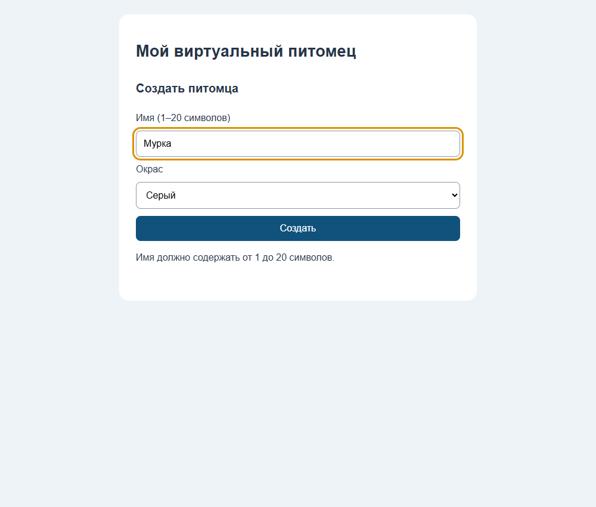
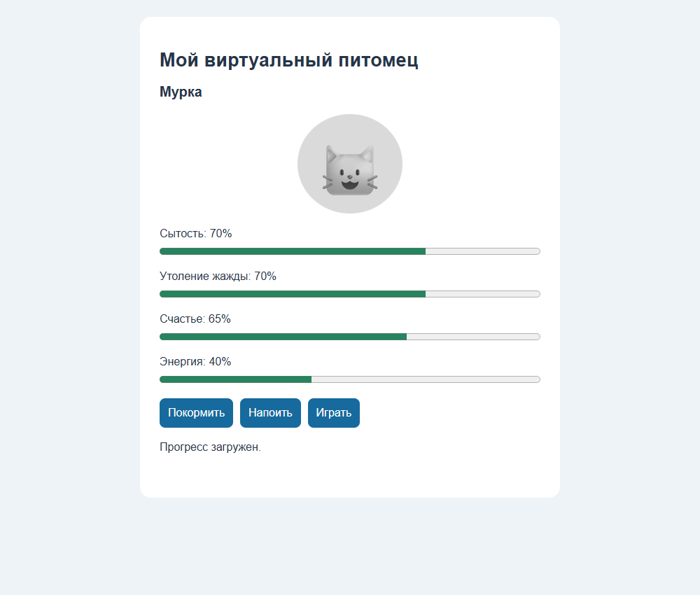
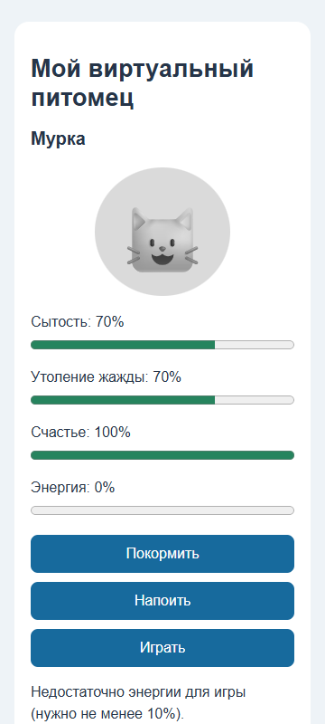
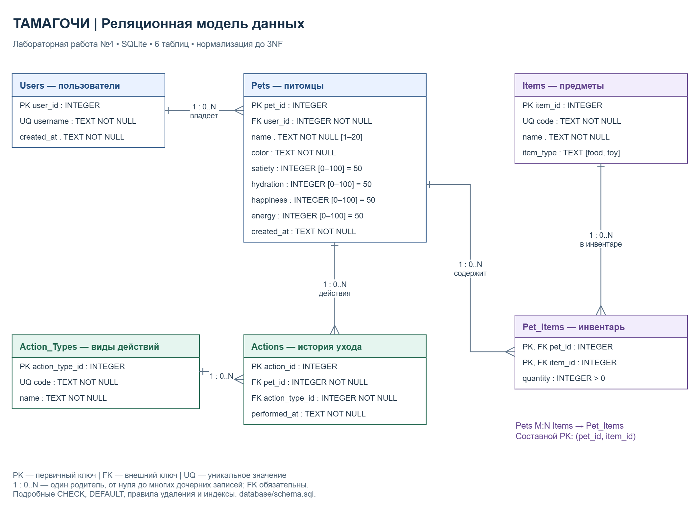

# Симулятор питомца (Тамагочи)

Учебный прототип на HTML/CSS/JavaScript, выполненный в рамках лабораторной работы №3 «Реализация, контроль версий и управление качеством кода».

## Запуск

Скачайте архив из [релиза v1.0.0](https://github.com/mon0max/Virtual-Pet-Simulator-Tamagotchi-SRS/releases/tag/v1.0.0), распакуйте и откройте `index.html` в современном браузере. Установка зависимостей и сборка не требуются.
Для стабильного хранения прогресса рекомендуется открывать приложение через локальный HTTP-сервер, например `python -m http.server 8000`, затем перейти на `http://localhost:8000`. Доступность localStorage при открытии через file:// зависит от браузера.

## Использование

1. Введите имя (от 1 до 20 символов после удаления пробелов по краям), выберите окрас и нажмите «Создать».
2. Питомец появится на главном экране со шкалами сытости, утоления жажды, счастья и энергии по 50%.
3. «Покормить» добавляет 20 к сытости, «Напоить» добавляет 20 к утолению жажды. При 100% показывается сообщение о насыщении.
4. «Играть» запускает анимацию, добавляет 15 к счастью и расходует 10 энергии. При энергии ниже 10% действие отклоняется с сообщением.
5. Все показатели ограничены диапазоном 0–100. Состояние сохраняется после создания и каждого действия и восстанавливается при открытии приложения в том же браузере и на том же адресе.

При недоступности хранилища появляется сообщение. Очистка данных браузера удаляет сохранение. Анимация учитывает системную настройку уменьшения движения.

## Объём версии

Реализованы согласованные задачи [#2](https://github.com/mon0max/Virtual-Pet-Simulator-Tamagotchi-SRS/issues/2), [#3](https://github.com/mon0max/Virtual-Pet-Simulator-Tamagotchi-SRS/issues/3), [#4](https://github.com/mon0max/Virtual-Pet-Simulator-Tamagotchi-SRS/issues/4). Остальные требования общего ТЗ остаются в беклоге. В этом прототипе нет восстановления энергии, сна, лечения и периодического изменения показателей. Полное выполнение задачи #7 о сохранении (таймер, сброс, защита от сбоев) в эту работу не входит.

## Проверки

```sh
node --check script.js
node --test
```

Тесты проверяют создание, границы имени, кормление, поение, игру, ограничения показателей и проверку сохранённых данных. GitHub Actions запускает проверки файлов, синтаксиса и тесты при push в main и PR в main.

В браузере Microsoft Edge проверены создание, уход, загрузка сохранения после перезагрузки, отказ при низкой энергии, отсутствие JavaScript-ошибок и горизонтальной прокрутки при ширине 360 px.

## Скриншоты





## Процесс разработки

Три задачи выполнены через отдельные ветки, PR, self-review с комментариями, разрешение обсуждений и слияние. PR #34 объединён методом Squash and merge.

- [PR #33 — создание питомца](https://github.com/mon0max/Virtual-Pet-Simulator-Tamagotchi-SRS/pull/33)
- [PR #34 — кормление и поение](https://github.com/mon0max/Virtual-Pet-Simulator-Tamagotchi-SRS/pull/34)
- [PR #35 — игра](https://github.com/mon0max/Virtual-Pet-Simulator-Tamagotchi-SRS/pull/35)
- [Процесс разработки в Wiki](https://github.com/mon0max/Virtual-Pet-Simulator-Tamagotchi-SRS/wiki/Процесс-разработки)
- [GitHub Actions](https://github.com/mon0max/Virtual-Pet-Simulator-Tamagotchi-SRS/actions)

## База данных — лабораторная работа №4

Спроектирована реляционная модель SQLite в 3NF: Users, Pets, Action_Types, Actions, Items и Pet_Items. Связь питомцев и предметов M:N реализована через инвентарь Pet_Items с составным первичным ключом. Модель использует сущности и требования проекта тамагочи; предметы и инвентарь включены из беклога #21.

- [ER-диаграмма PNG](docs/database/er_diagram.png)
- [ER-диаграмма SVG](docs/database/er_diagram.svg)
- [Редактируемый исходник draw.io](docs/database/er_diagram.drawio) — скачайте файл и откройте через «Файл → Открыть с → Устройство» в draw.io.
- [Анализ предметной области](docs/database/domain-analysis.md)
- [Схема SQL с ограничениями и индексами](database/schema.sql)
- [Тестовые данные](database/seed_data.sql)
- [Обоснование нормализации 1NF → 2NF → 3NF](database/normalization.md)
- [Документация в Wiki](https://github.com/mon0max/Virtual-Pet-Simulator-Tamagotchi-SRS/wiki/normalization)



Для проверки нужен Python со встроенным SQLite 3.37+; дополнительные пакеты не требуются:

```sh
python tests/database_test.py
```

Тесты создают БД в памяти, выполняют schema.sql и seed_data.sql, проверяют связи, ограничения, значения по умолчанию, индексы, удаление и запросы к истории/инвентарю. Они запускаются также в CI.

Для ручной проверки запустите `sqlite3 tamagotchi.db` из корня репозитория и выполните:

```sql
.read database/schema.sql
.read database/seed_data.sql
PRAGMA foreign_key_check;
PRAGMA integrity_check;
```

Ожидается отсутствие нарушений внешних ключей и результат `ok`. Скрипты выполняются один раз в пустой БД. Внешние ключи включаются командой `PRAGMA foreign_keys = ON` на каждом новом соединении до транзакции.

Лабораторная №4 добавляет проектирование и SQL-артефакты. Веб-прототип продолжает сохранять состояние в localStorage; подключение БД, магазин и экономика остаются в беклоге.
