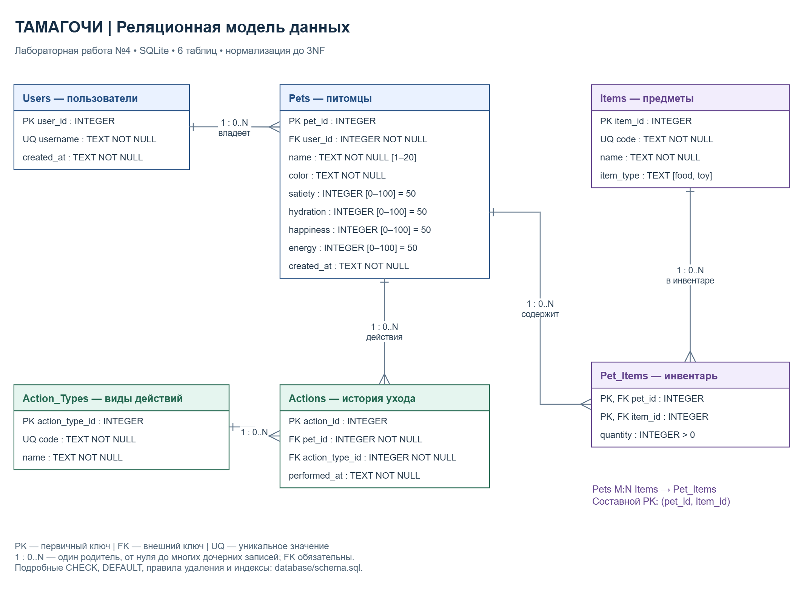

# Процесс проектирования и нормализации базы данных

## Область модели и требования

Лабораторная работа №4 продолжает проект «Симулятор питомца (Тамагочи)». СУБД — SQLite 3.37 или новее. Сущности выявлены по [ТЗ](https://github.com/mon0max/Virtual-Pet-Simulator-Tamagotchi-SRS/wiki/Техническое-задание), задачам #2–5, #21, #24. Анализ: [domain-analysis.md](../docs/database/domain-analysis.md).

Включены пользователи, питомцы с четырьмя показателями текущего прототипа, история и виды действий ухода, каталог предметов и инвентарь. Связь M:N через инвентарь согласована для этой работы. Категории и задачи из примера методички заменены сущностями тамагочи.

Границы: создаётся проект БД и выполняемые SQL-скрипты. Подключение БД к интерфейсу, магазин, авторизация, уведомления, здоровье и лечение как игровая механика, экономика и расширенное сохранение остаются в соответствующих задачах беклога. Коды sleep/heal в справочнике предусмотрены исходным ТЗ; формулы для них не вводятся. Email и пароль не добавляются, поскольку авторизация не входит в согласованную модель.

## 1. Исходная (денормализованная) структура

Для объяснения рассматриваем учебную «плохую» структуру, а не утверждаем, что она уже существовала в приложении:

```text
Pet_Care_Flat (
  pet_id, pet_name, color, satiety, hydration, happiness, energy, pet_created_at,
  user_id, username, user_created_at,
  inventory = [(item_id, item_code, item_name, item_type, quantity), ...],
  actions = [(action_id, action_type_id, action_code, action_name, performed_at), ...]
)
```

Пример: одна запись питомца хранит предметы «корм: 3; мячик: 1» и список «кормление; поение; игра». Эти списки — повторяющиеся группы, а не атомарные значения.

Проблемы:

- Избыточность: имя владельца повторяется у его питомцев; описание одного товара повторяется в разных инвентарях; название действия повторяется в истории.
- Аномалия обновления: переименование корма требует исправить все инвентари; переименование владельца — все его записи.
- Аномалия вставки: нельзя завести владельца без питомца или товар без владельца инвентаря.
- Аномалия удаления: вместе с последним питомцем можно потерять владельца; вместе с последней строкой инвентаря — описание товара.

## 2. Нормализация до 1NF

**Цель:** атомарные значения, отсутствие списков и повторяющихся групп, определённые ключи.

Разворачиваем инвентарь: одна строка на один вид предмета у одного питомца. Историю выделяем независимо: одна строка на одно событие. Это не создаёт произведение всех действий на все предметы.

```text
Inventory_1NF (
  pet_id, item_id, user_id, username, user_created_at,
  pet_name, color, satiety, hydration, happiness, energy, pet_created_at,
  item_code, item_name, item_type, quantity
)
PK = (pet_id, item_id)

Care_1NF (
  action_id, pet_id, action_type_id, action_code, action_name, performed_at
)
PK = action_id
```

Для питомцев без предметов сохраняем самостоятельные записи о питомцах: отсутствие инвентаря не должно удалять сам объект. Временная Inventory_1NF используется только как иллюстрация зависимостей, не как SQL для эксплуатации.

**Результат:** в каждой ячейке одно значение, но атрибуты ещё избыточны. Число quantity — количество одинаковых экземпляров, а не список экземпляров.

## 3. Нормализация до 2NF

**Цель:** устранить зависимость неключевого атрибута только от части составного ключа.

В Inventory_1NF ключ — **(pet_id, item_id)**:

```text
pet_id → user_id, username, user_created_at,
         pet_name, color, satiety, hydration, happiness, energy, pet_created_at
item_id → item_code, item_name, item_type
(pet_id, item_id) → quantity
```

Данные питомца зависят только от pet_id; описание предмета — только от item_id. Это частичные зависимости. Выделяем Pets_2NF и Items, а в Pet_Items оставляем только составной ключ и quantity.

```text
Pets_2NF (pet_id PK, user_id, username, user_created_at,
          name, color, satiety, hydration, happiness, energy, created_at)
Items (item_id PK, code UNIQUE, name, item_type)
Pet_Items (pet_id PK/FK, item_id PK/FK, quantity)
```

В Care_1NF первичный ключ простой (action_id), поэтому частичных зависимостей от его части нет: эта таблица уже удовлетворяет 2NF. Зависимость action_id → action_type_id → action_name является транзитивной и устраняется на следующем шаге.

**Результат:** quantity зависит от пары целиком, атрибуты предмета и питомца больше не повторяются в каждой паре инвентаря. У таблиц с простым ключом 2NF выполняется после 1NF при принятых зависимостях; перенос имени владельца объясняется 3NF, а не частичной зависимостью от простого pet_id.

## 4. Нормализация до 3NF

**Цель:** устранить транзитивные зависимости неключевых атрибутов через другие неключевые атрибуты.

В Pets_2NF:

```text
pet_id → user_id → username, user_created_at
```

Создаём Users (user_id, username, created_at), а в Pets оставляем user_id как обязательный FK. Имя и дата создания владельца не хранятся в питомце.

В Care_1NF:

```text
action_id → action_type_id → action_code, action_name
```

Создаём Action_Types (action_type_id, code, name). В Actions остаются action_id, pet_id, action_type_id, performed_at. Название вида действия хранится один раз в справочнике.

**Результат:** транзитивные зависимости устранены. Имена питомцев и владельцев, названия предметов и видов действий не смешиваются с чужими сущностями.

### Функциональные зависимости и обоснование финальной схемы

| Таблица | Ключи-кандидаты | Зависимости неключевых атрибутов |
| --- | --- | --- |
| Users | user_id; username | каждый ключ → остальные поля пользователя |
| Pets | pet_id | pet_id → user_id, name, color, satiety, hydration, happiness, energy, created_at |
| Action_Types | action_type_id; code | каждый ключ → остальные поля вида действия |
| Actions | action_id | action_id → pet_id, action_type_id, performed_at |
| Items | item_id; code | каждый ключ → остальные поля предмета |
| Pet_Items | (pet_id, item_id) | (pet_id, item_id) → quantity |

При этих зависимостях все таблицы находятся в 3NF. Уникальность имени питомца, названия предмета или вида действия не предполагается: для справочников идентичность задаётся уникальным code. Текущие шкалы — состояние питомца; между шкалами нет заданных функциональных зависимостей. История хранит факты событий, а не копии текущего состояния.

## 5. Реализация связи «многие ко многим» (M:N)

Один питомец может иметь разные предметы; один вид предмета может встречаться у разных питомцев. Связь **Pets M:N Items** реализуется через **Pet_Items**:

```text
Pets 1 → 0..N Pet_Items
Items 1 → 0..N Pet_Items
Pet_Items PK = (pet_id, item_id)
```

Оба FK обязательны. Повторная пара запрещена составным PK; количество одинаковых экземпляров задаёт quantity > 0. Нулевое количество представляется отсутствием строки. Остальные связи: Users 1:N Pets, Pets 1:N Actions, Action_Types 1:N Actions. На стороне дочерней таблицы ссылка всегда на одного родителя; родитель может не иметь дочерних записей.

## 6. Финальная схема и словарь данных



- [Редактируемая схема draw.io](../docs/database/er_diagram.drawio)
- [Векторный экспорт SVG](../docs/database/er_diagram.svg)
- [DDL и индексы](schema.sql)
- [Тестовые данные](seed_data.sql)

| Таблица | Поля |
| --- | --- |
| Users | user_id INTEGER PK; username TEXT NOT NULL UNIQUE (непустое, без крайних пробелов); created_at TEXT NOT NULL, по умолчанию текущее время UTC |
| Pets | pet_id INTEGER PK; user_id INTEGER NOT NULL FK; name TEXT NOT NULL (1–20 символов без крайних пробелов); color TEXT NOT NULL (ginger/gray/white); satiety, hydration, happiness, energy INTEGER NOT NULL (0–100, DEFAULT 50); created_at TEXT NOT NULL, текущее время UTC |
| Action_Types | action_type_id INTEGER PK; code TEXT NOT NULL UNIQUE (непустой, без крайних пробелов); name TEXT NOT NULL, непустое |
| Actions | action_id INTEGER PK; pet_id INTEGER NOT NULL FK; action_type_id INTEGER NOT NULL FK; performed_at TEXT NOT NULL, по умолчанию текущее время UTC |
| Items | item_id INTEGER PK; code TEXT NOT NULL UNIQUE (непустой, без крайних пробелов); name TEXT NOT NULL, непустое; item_type TEXT NOT NULL (food/toy) |
| Pet_Items | pet_id INTEGER NOT NULL PK/FK; item_id INTEGER NOT NULL PK/FK; quantity INTEGER NOT NULL > 0 |

Все таблицы STRICT: допускаются значения подходящего типа или без потерь приводимые к нему. Несовместимый текст и дробные значения в целых показателях отклоняются. Имена в SQLite ограничиваются через length, считающую символы Unicode; текущий JS-прототип использует length строки JavaScript (кодовые единицы UTF-16). При будущем подключении БД нужна единая политика длины для символов вне BMP; для обычных русских/латинских букв ограничения совпадают.

Даты хранятся как TEXT в договорённом UTC-формате YYYY-MM-DD HH:MM:SS; DEFAULT задаёт время через datetime('now'). Формат вручную переданных дат не проверяется отдельным CHECK: его должен контролировать будущий слой записи. Показатель hydration означает утоление жажды: увеличение соответствует действию «Напоить».

### Ссылочная целостность и удаление

- Users → Pets: ON DELETE CASCADE. При удалении владельца удаляются его питомцы.
- Pets → Actions и Pet_Items: ON DELETE CASCADE. История и инвентарь принадлежат питомцу и удаляются вместе с ним.
- Action_Types → Actions: ON DELETE RESTRICT. Используемый вид действия нельзя удалить, сохранив события без расшифровки.
- Items → Pet_Items: ON DELETE RESTRICT. Используемый товар нельзя удалить, пока он есть в инвентарях.
- Изменение идентификаторов не предполагается; ON UPDATE использует стандартный NO ACTION.

Данные владельца сохраняются при удалении его последнего питомца. Предметы и виды действий сохраняются при удалении последнего использующего их питомца.

**Важно:** PRAGMA foreign_keys = ON выполняется на каждом соединении до начала транзакции. Оба SQL-скрипта включают её явно.

### Индексы

| Индекс | Назначение |
| --- | --- |
| idx_pets_user_id | поиск питомцев владельца и проверка дочерних записей при удалении пользователя |
| idx_actions_pet_time | хронологическая история одного питомца; начальный столбец покрывает FK pet_id |
| idx_actions_type_id | отбор по виду действия и проверка ссылок на справочник |
| idx_pet_items_item_id | поиск владельцев предмета и проверка ссылок на каталог |

UNIQUE для username/code и составной PK Pet_Items создают индексы автоматически. PK Pet_Items начинается с pet_id и покрывает поиск инвентаря питомца; дублировать его отдельным индексом не требуется.

## 7. Выполнение SQL и тестовые данные

В новой БД через SQLite CLI:

```sh
sqlite3 tamagotchi.db
```

```sql
.read database/schema.sql
.read database/seed_data.sql
PRAGMA foreign_keys;
PRAGMA foreign_key_check;
PRAGMA integrity_check;
```

Команды .read выполняются из корня репозитория и являются командами SQLite CLI, а не частью SQL. Ожидается foreign_keys = 1, пустой результат foreign_key_check, integrity_check = ok. seed_data.sql рассчитан на однократное выполнение после schema.sql в пустой БД; повторный запуск намеренно завершается ошибкой уникальности, а не дублирует тестовые данные. Данные демонстрационные, не персональные.

Набор данных: 2 владельца, 3 питомца, 5 видов действий, 4 события, 3 предмета, 4 строки инвентаря. У Мурки состояние соответствует действиям прототипа: 50 → 70 сытости, 50 → 70 утоления жажды, счастье 65, энергия 40. История и шкалы в этой работе не синхронизируются триггерами: при подключении БД слой приложения должен обновлять состояние и писать событие в одной транзакции.

Пример M:N-запроса:

```sql
SELECT p.name AS pet, i.name AS item, pi.quantity
FROM Pet_Items AS pi
JOIN Pets AS p ON p.pet_id = pi.pet_id
JOIN Items AS i ON i.item_id = pi.item_id
ORDER BY p.pet_id, i.item_id;
```

Пример истории:

```sql
SELECT a.performed_at, t.name
FROM Actions AS a
JOIN Action_Types AS t ON t.action_type_id = a.action_type_id
WHERE a.pet_id = 1
ORDER BY a.performed_at, a.action_id;
```

Проверки без создания файлов БД:

```sh
python tests/database_test.py
node --test
```

Семь тестов SQLite выполняются в памяти. Проверяются схема и seed, M:N и история, значения по умолчанию и границы имени, ограничения целостности и типов, каскадное удаление, RESTRICT и наличие индексов. Проверки включены в GitHub Actions вместе с существующими тестами прототипа.

## 8. Интеграция результатов в проект

- [#36 — анализ предметной области](https://github.com/mon0max/Virtual-Pet-Simulator-Tamagotchi-SRS/issues/36).
- [#37 — проектирование и нормализация БД](https://github.com/mon0max/Virtual-Pet-Simulator-Tamagotchi-SRS/issues/37).
- Ветка design/database-model; последовательные коммиты анализа, диаграммы, SQL и документации.
- Один PR связывает обе Issues через Closes, содержит self-review и проходит CI перед слиянием в main.
- Документация опубликована также на [Wiki-странице normalization](https://github.com/mon0max/Virtual-Pet-Simulator-Tamagotchi-SRS/wiki/normalization).

Задача #10 о настройке подключения и миграциях не закрывается этой работой: проектирование схемы ещё не подключает БД к приложению. Задача #21 о магазине также остаётся открытой.

## Технические источники

- [SQLite: внешние ключи, включение и индексы](https://www.sqlite.org/foreignkeys.html).
- [SQLite: STRICT tables и версия 3.37+](https://www.sqlite.org/stricttables.html).
- [draw.io: загрузка XML и экспорт через embed-протокол](https://www.drawio.com/docs/reference/embed-mode/).
